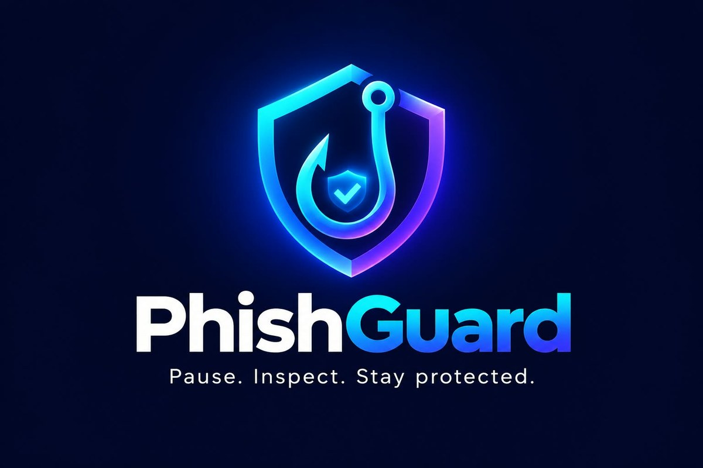

<p align="center"></p>

# PhishGuard – Pause. Inspect. Stay protected.

Explainable phishing / URL security analysis. Static URL analysis + optional Google Safe Browsing lookup,
a transparent 0–100 score, browser-local history, report export and a learning center.

```
phishguard/
├─ backend/    FastAPI service  (app/, tests/, eval/)
├─ frontend/   React + Vite + TypeScript + Tailwind
├─ docs/       ARCHITECTURE.md, DEMO_SCRIPT.md
└─ render.yaml Render blueprint for the backend
```

## Run locally (Windows PowerShell)
```powershell
# Backend
cd backend
python -m venv .venv
Set-ExecutionPolicy -Scope Process -ExecutionPolicy Bypass   # only if activation is blocked
.\.venv\Scripts\Activate.ps1
pip install -r requirements.txt
pytest -q
uvicorn app.main:app --reload --port 8000

# Frontend (second window)
cd frontend
Copy-Item .env.example .env
npm install
npm run dev          # http://localhost:5173
```
Optional: `$env:GOOGLE_SAFE_BROWSING_API_KEY="..."` before starting uvicorn to enable reputation lookups.
Without a key the app runs in heuristic-only mode and reports the provider as "Not checked".

## Deploy
1. **Backend → Render.** Push this repo to GitHub → Render → New → Blueprint → select the repo (uses `render.yaml`).
   Set `PHISHGUARD_CORS_ORIGINS` to your Vercel URL (no trailing slash). Optionally set `GOOGLE_SAFE_BROWSING_API_KEY`.
   Check `https://<service>.onrender.com/health`. Free instances sleep when idle, so the first request can be slow.
2. **Frontend → Vercel.** Import the repo, set **Root Directory** to `frontend` (framework: Vite). Add env var
   `VITE_API_BASE_URL=https://<service>.onrender.com` and deploy. `vercel.json` rewrites routes to the SPA.
3. Redeploy the backend if you changed `PHISHGUARD_CORS_ORIGINS` after the first deploy, then test a scan from the live site.

## Scoring
score = min(100, sum of the highest-weight finding per indicator group). 0–24 lower observed risk, 25–49 caution,
50–74 high concern, 75–100 very high concern. Weights/thresholds are configurable starting points (`backend/app/config.py`,
`PHISHGUARD_THRESHOLDS`), **not** calibrated probabilities. Only a reputation `match` can add a large jump; `no_match`
never lowers a score or implies safety.

## Evaluation
`python backend/eval/run_eval.py [--threshold 25]` runs the heuristics on `backend/eval/dataset.csv`
(46 hand-written URLs). It is a regression check, not evidence of real-world accuracy: the dataset is small and was
written alongside the rules.

## Known limitations
- Registered-domain splitting uses a small built-in suffix list (heuristic); brand list has 17 brands and can miss or misfire.
- Lone look-alike signals score 40–45 (Caution), by design of the initial weights; recalibrate against a larger dataset.
- Safe Browsing Lookup API terms apply (review Google's terms before production or commercial use).
- Not implemented: AI-written explanations (deterministic ones are used), browser extension, server-side history/accounts.
- Rate limiting is in-memory per instance and resets on restart.
